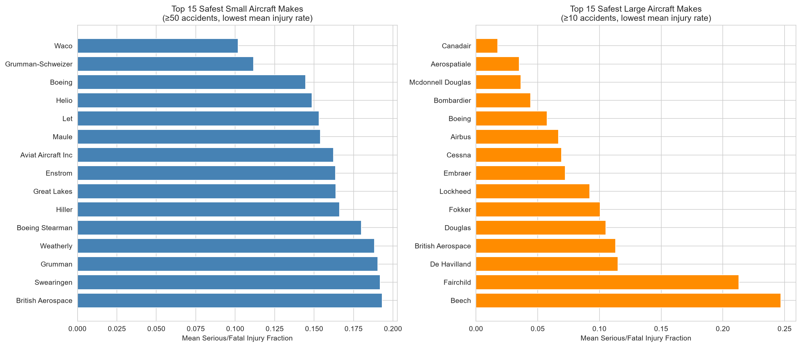
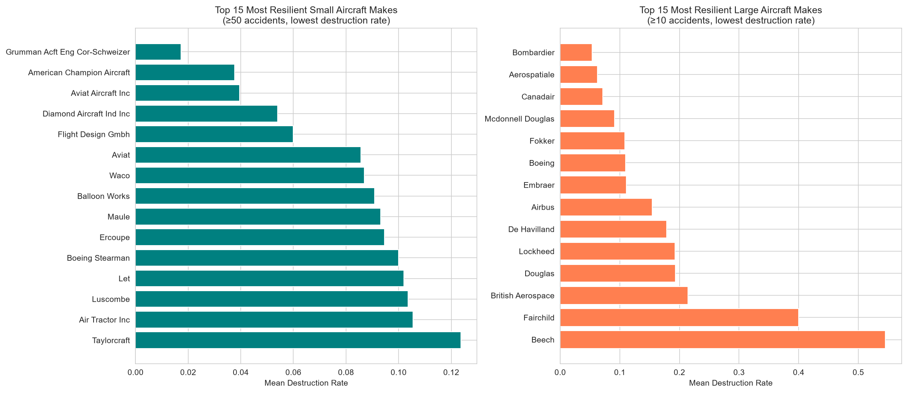
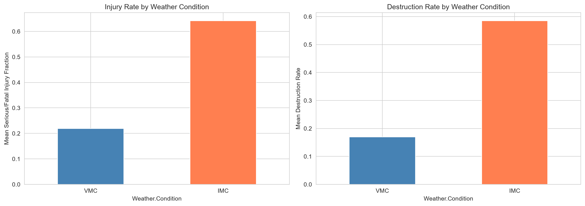
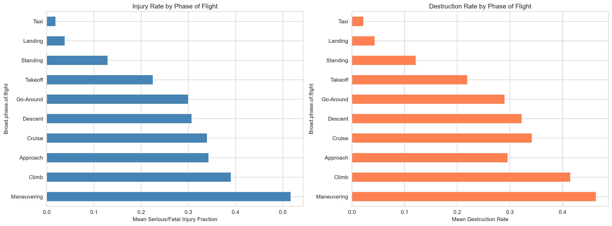

# Aviation Accident Analysis

## Overview

This project analyzes NTSB aviation accident data (1948–2022) on behalf of an airline/airplane insurer. The goal is to identify aircraft makes and models with the lowest rates of total destruction and the lowest likelihood of fatal or serious passenger injuries, and to surface key factors that influence accident outcomes.

## Data

- **Source:** NTSB Aviation Accident Database (`AviationData.csv`) — 88,889 records covering accidents from October 1948 to December 2022.
- **Key columns:** Make, Model, Event.Date, Aircraft.Category, Amateur.Built, Total.Fatal.Injuries, Total.Serious.Injuries, Total.Minor.Injuries, Total.Uninjured, Aircraft.damage, Weather.Condition, Broad.phase.of.flight.

## Methodology

### Data Cleaning (`Aviation_Accidents_Cleaning.ipynb`)

1. **Filtered** to professional-build airplanes with events from 1983 onward (40-year active lifetime assumption).
2. **Imputed** missing injury counts as 0 (assumption: a missing count means none were recorded in that category).
3. **Created** two key metrics:
   - **Serious/Fatal Injury Fraction** = (Fatal + Serious Injuries) / Total People on Board
   - **Destroyed** (binary) = 1 if the aircraft was destroyed, 0 otherwise.
4. **Cleaned** Make and Model columns (casing, whitespace, variant merging such as `Air Tractor Inc` → `Air Tractor`, `Aviat Aircraft Inc` → `Aviat`, `American Champion Aircraft` → `Champion`).
5. **Removed non-airplanes** that entered via a missing `Aircraft.Category`, after a model-level verification:
   - helicopter manufacturers (Bell, Robinson, Hughes, Schweizer, Sikorsky, Eurocopter, Agusta, Enstrom, Hiller);
   - balloon manufacturers (Balloon Works, whose models are all *Firefly* hot-air balloons);
   - glider models filtered at model level: `Let` records except the L-410 airplane (L-13 / L-23 Blaník gliders), and `Burkhart Grob` records except G115 / G120 trainers (G102 / G103 gliders, G109 motor-gliders).
6. **Kept** only makes with ≥50 accidents.
7. **Standardized** Engine.Type, Weather.Condition, Purpose.of.flight, and Broad.phase.of.flight. Replaced placeholders (0 engines, "Unknown") with NaN and grouped rare categories into "Other".
8. **Removed** columns with excessive missing data (≤20,000 non-null values).

### Exploratory Data Analysis (`Aviation_Accidents_Data_Analysis.ipynb`)

Aircraft were split into **small** (≤20 passengers) and **large** (>20 passengers) groups, then analyzed by:

- Mean serious/fatal injury fraction by manufacturer (top 15 safest)
- Distributional plots (violin for small, strip for large)
- Mean destruction rate by manufacturer (top 15 most resilient)
- Specific aircraft types (Make + Model) with ≥10 accidents

Two contributing factors were investigated: **Weather Condition** and **Phase of Flight**.

## Key Results

All rankings use sample-size thresholds (≥50 accidents for small-aircraft makes, ≥10 for large-aircraft makes and for specific types) so that every recommendation rests on a meaningful number of observations.

### Small Aircraft Recommendations
- **Top makes (in both injury and destruction Top 15):** Waco (mean injury 0.10, n=139), Maule (0.15, n=570), Aviat (0.XX, n=XXX), Boeing Stearman (0.18, n=50), [UPDATE: fifth make from the new Top 15].
- **Top types (≥10 accidents):** Piper PA-18A 150 (0.00, n=12), Cessna 180C (0.00, n=15), Grumman G164B (0.00, n=16), Maule MX-7-235 (0.03, n=17), Cessna 560XL (0.04, n=25).

### Large Aircraft Recommendations
- **Top makes:** Canadair (0.02, n=21), Aerospatiale (0.04, n=34), Mcdonnell Douglas (0.04, n=329), Bombardier (0.04, n=83), Boeing (0.06, n=1,391).
- **Top types:** Mcdonnell Douglas MD-83 (0.001, n=18), MD-80 (0.001, n=15), Boeing 717-200 (0.001, n=15), Boeing 737-322 (0.001, n=12), Boeing 757-251 (0.001, n=10).

### Contributing Factors
1. **Weather Condition:** IMC accidents have a mean injury fraction of 0.64 (n=4,987), roughly three times higher than VMC at 0.22 (n=54,623). Destruction rates show the same pattern (0.58 vs. 0.17).
2. **Phase of Flight:** Maneuvering is the most dangerous phase (mean injury 0.52, n=4,968), followed by Climb (0.39) and Cruise/Approach (~0.34). Landing (0.04, n=12,341) and Taxi (0.02, n=1,616) are the safest.

## Visualizations

Key plots are saved in the `images/` directory:









## Limitations

- **Accident-only data:** The dataset contains only accidents, not all flights. Our metrics measure *severity given an accident occurred*, not the frequency of accidents. A true risk assessment would also require flight-hour data, which is not available here.
- **Crew included in passenger count:** "Total People on Board" includes both crew and passengers. This inflates the denominator for small aircraft (where the crew is a large fraction of occupants) and may slightly deflate injury fractions.
- **Misclassification at the size threshold:** A large-capacity aircraft flying with few people on board (e.g., a ferry or cargo flight) is classified as "small" under our ≤20 threshold. This is a limitation of using per-accident headcount rather than aircraft seating capacity.
- **Heuristic removal of non-airplanes:** Because `Aircraft.Category` is missing for most records, helicopters, balloons and gliders were removed by manufacturer and model name. This catches the frequent cases but cannot guarantee that every non-airplane record has been excluded.
- **No statistical hypothesis testing:** Comparisons are based on mean differences and sample sizes, not formal tests (t-test, etc.). We use the word "notably" rather than "significantly" to avoid implying statistical significance that has not been established.

## Repository Structure

```
├── Aviation_Accidents_Cleaning.ipynb    # Data cleaning notebook
├── Aviation_Accidents_Data_Analysis.ipynb # EDA and analysis notebook
├── data/
│   ├── AviationData.csv                 # Raw dataset
│   ├── AviationData_cleaned.csv         # Cleaned dataset (generated)
│   └── USState_Codes.csv                # State code reference
├── images/                              # Saved plots (generated)
├── README.md
└── LICENSE
```
